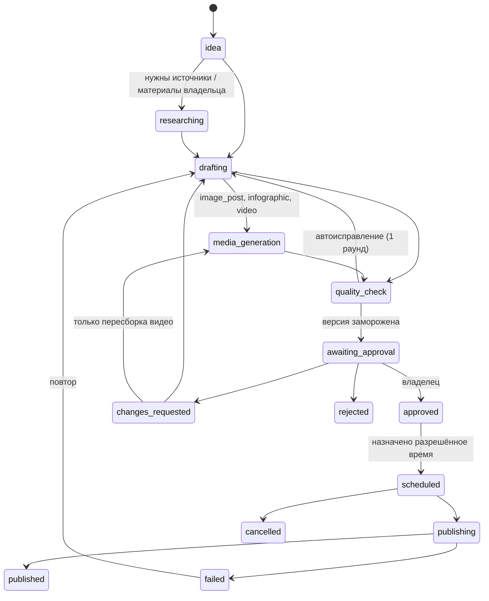

# Архитектура

## Компоненты

| Компонент из задачи | Где реализован | Тип |
|---|---|---|
| Agent Orchestrator | `app/orchestration/pipeline.py`, `handlers.py`, `queue.py` | детерминированный код |
| Research Agent | `app/agents/research.py`, `providers/search/` | модель + проверка цитат кодом |
| Content Strategist | `app/agents/strategist.py`, `publishing/slots.py` | слоты и форматы — код, смысл — модель |
| Copywriter Agent | `app/agents/copywriter.py` | модель + очистка HTML |
| Visual Agent | `app/agents/visual.py`, `media/templates.py`, `config/templates.yaml` | шаблоны Pillow; ИИ-иллюстрации и проверка зрением — модель |
| Video Editor Agent | `app/agents/video_editor.py`, `video/` | FFmpeg; сопоставление фрагментов и сцен — модель (необязательно) |
| AI Video Agent | `app/agents/ai_video.py`, `providers/video/` | адаптеры Sora/Runway |
| Quality Assurance Agent | `app/agents/qa.py` | правила + модель |
| Approval Service | `app/approval/service.py`, `approval/bot.py` | код |
| Publishing Service | `app/publishing/service.py` | код |
| Analytics Agent | `app/analytics/`, `agents/analytics.py` | расчёты — код, формулировки — модель (необязательно) |
| Admin API | `app/api/` | FastAPI + панель `/admin` |
| Media Storage | `app/providers/storage/`, `media/assets.py` | S3 / локальный диск |
| Scheduler | `app/orchestration/scheduler.py` | код |
| Monitoring Service | `app/monitoring/` | логи, метрики, Sentry, уведомления, сводки |

Языковая модель одна на все агенты (`providers/llm`). Агенты отличаются системными инструкциями (`app/agents/prompts/*.md`) и схемами ответа (Pydantic). Модель не получает инструментов публикации и ничего не исполняет: она возвращает структуру, которую проверяет код. Решения о статусах, расписании, бюджете и публикации принимает детерминированный код.

## Конвейер

Один обработчик `pipeline.advance` смотрит на статус материала и выполняет следующий шаг. Долгие операции (модель, рендер) идут без блокировки строки; результат применяется в короткой транзакции только если статус и текущая версия не изменились (`_apply`). Если владелец отменил материал во время генерации, результат отбрасывается.

## Версии и одобрение

- Каждая правка создаёт новую версию (`content_versions`), прежнее одобрение снимается событием `invalidated`.
- Перед отправкой владельцу версия замораживается: вычисляется SHA-256 канонического представления (заголовок, текст, опрос, хештеги, параметры публикации, медиа с их SHA-256). Триггеры PostgreSQL запрещают менять содержимое замороженной версии, её набор медиа и идентичность файлов (`storage_key`, `sha256`, `size_bytes`).
- Одобрение (`approval_events`) хранит версию и хеш. Кнопки бота содержат ID версии: нажатие на устаревшую версию отклоняется.
- Перед публикацией хеш пересчитывается, файлы скачиваются и сверяются по SHA-256, проверяются права одобрившего, отсутствие отмен и пауз.

## Почему очередь на PostgreSQL, а не Redis/Celery или n8n

Нагрузка — до 7 публикаций и десятки задач в час. Главное требование — согласованность: задача ставится в той же транзакции, что и смена статуса (`enqueue` внутри `session_scope`), поэтому не бывает «статус сменился, а задача потерялась». Очередь (`tasks`) использует `SELECT … FOR UPDATE SKIP LOCKED`, аренду с продлением (heartbeat), экспоненциальные повторы, `Reschedule` без расхода попыток (ожидание внешнего сервиса), `dedup_key` (одна ожидающая задача на ключ, задачи с одним ключом выполняются последовательно) и `once_key` (разовый запуск периодической задачи). Отдельный брокер добавил бы второе хранилище состояния без выигрыша.

n8n не используется: вся логика в Python, в одном месте, покрыта тестами. Дублировать её в визуальном редакторе нельзя по условию задачи, а вынос части логики в n8n лишил бы её транзакционных гарантий.

## Защита от повторной публикации

1. `publishing_jobs.version_id` уникален — одна публикация на одобренную версию.
2. Частичный уникальный индекс: у материала не может быть двух заданий в статусах `pending/sending/succeeded/uncertain`.
3. Задание переводится в `sending` под блокировкой строки до запроса в Telegram. Повторная доставка задачи видит `sending/succeeded/uncertain` и ничего не отправляет.
4. Клиент Telegram различает «запрос не дошёл» (нет соединения — безопасный повтор) и «ответ потерян» (обрыв при чтении — статус `uncertain`, владельцу уведомление, автоповтора нет).
5. `publishing_results.item_id` уникален; сохраняются все message ID.

## Процессы

| Процесс | Команда | Что делает |
|---|---|---|
| api | `uvicorn app.api.main:app` | Admin API, панель, `/r/<код>`, вебхук Telegram, метрики |
| worker | `python -m app.workers.worker` | фоновые задачи (`WORKER_CONCURRENCY` параллельно) |
| scheduler | `python -m app.workers.scheduler` | периодические задачи (несколько экземпляров не дублируют) |
| bot | `python -m app.workers.bot` | long polling Telegram (в режиме вебхука не нужен) |

Периодические задачи: публикация наступивших (каждую минуту), запуск подготовки (30 мин), сторож видео-заданий (10 мин), обслуживание (15 мин), план на 7 дней (06:00), сбор статистики (23:30), недельный отчёт (пн 10:00) — по часовому поясу канала.

## Данные

Таблицы из задачи: `users`, `channel_configs`, `content_plans`, `content_items`, `content_versions`, `research_sources`, `media_assets`, `video_jobs`, `approval_events`, `publishing_jobs`, `publishing_results`, `analytics_snapshots`, `provider_usage`, `audit_logs`. Дополнительно: `company_facts` (утверждённые сведения о компании), `version_media` (медиа версии), `tasks` (очередь), `tracked_links`/`link_clicks`, `bot_conversations`, `bot_state`, `notifications`. Все ключи — UUID, время — `timestamptz` в UTC, статусы — строки с CHECK-ограничениями.
